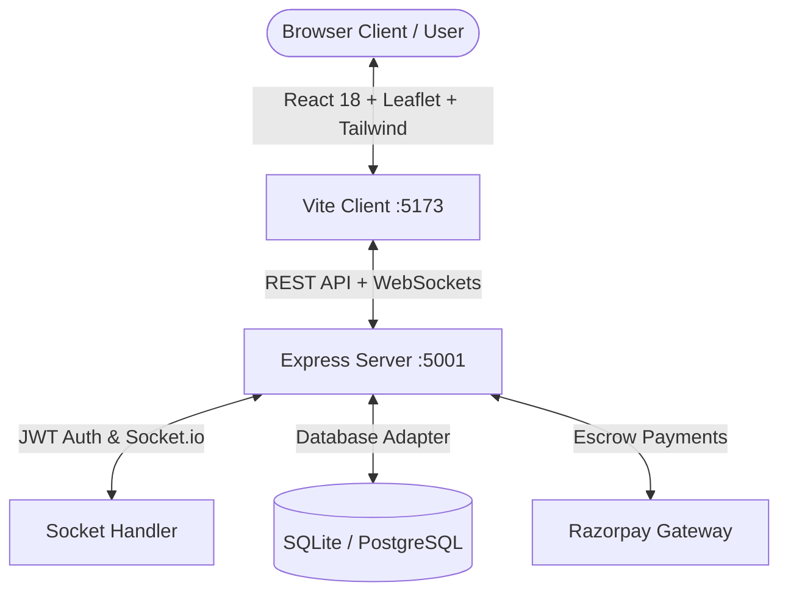

# CampusNeighbor 🏘️🎓
### Hyperlocal Neighborhood Student Help Marketplace

[](LICENSE)
[](https://nodejs.org/)
[](https://react.dev/)
[](https://www.typescriptlang.org/)
[](https://tailwindcss.com/)
[](https://leafletjs.com/)
[](https://socket.io/)

A modern, full-stack, responsive web application connecting busy neighborhood residents who need quick assistance with everyday chores to local university students who want to earn flexible part-time income.

---

## 📑 Table of Contents
- [Key Features](#-key-features)
- [Architecture & Tech Stack](#-architecture--tech-stack)
- [Project Structure](#-project-structure)
- [Quick Start Guide](#-quick-start-guide)
- [Pre-Seeded Demo Accounts](#-pre-seeded-demo-accounts)
- [API Endpoints](#-api-endpoints)
- [Testing](#-testing)
- [Deployment](#-deployment)
- [Security & Escrow System](#-security--escrow-system)
- [License](#-license)

---

## 🌟 Key Features

### 1. Three Dedicated User Roles & Dashboards
- **Neighbor / Customer:** Post chores, set geolocation & budget in ₹ (INR), review student applicants, inspect credentials & ratings, hire helpers into escrow, chat in real-time, confirm task completion, and review student helpers.
- **Student / Helper:** Verified student profile with college & skills, customizable working radius slider (1–25 km), browse nearby tasks on an interactive map, apply with proposed fees and pitch notes, update chore progress, mark completion, and receive earnings.
- **Administrator Console:** Live platform KPI metrics (active users, total tasks, active escrow volume, pending reports), user account management (activate/suspend/verify), chore moderation & overrides, incident dispute handling, and category management.
- **Customizable Profiles:** Upload profile pictures (PNG/JPG/WEBP) or generate stylized avatars, and freely update display names across all roles.

### 2. Hyperlocal Discovery & OpenStreetMap Integration
- **Interactive Leaflet / OpenStreetMap:** Live map displaying task pins color-coded by status and labeled with budgets in ₹ INR.
- **Distance-Based Filtering:** Haversine formula calculation computing distance in kilometers between student and task location.
- **Configurable Radius Slider:** Filter chores within 1 km to 25 km of current location.
- **One-Click GPS Location:** Geolocation detection with graceful fallback to locality search.

### 3. Escrow & Indian Payment Gateway (Razorpay)
- **Agreed Task Pricing:** Displays clear budgets in Indian Rupees (₹ INR).
- **Escrow Protection:** Funds are deposited into escrow upon hiring and held securely until the neighbor confirms completion.
- **Razorpay Integration:** Pre-configured for Razorpay India gateway checkout, with clearly labeled test mode simulation and transaction ledger.

### 4. Real-Time In-App Messaging & Notifications
- **Socket.io WebSockets:** Live messaging between assigned neighbors and students with instant updates and unread counters.
- **Notification Center:** Dropdown bell and real-time toast alerts for new applications, hire status, completion confirmation, and payments.

### 5. 9 Core Task Categories
1. 🛒 **Grocery and Shopping Assistance**
2. 🧹 **Home Assistance**
3. 🐾 **Pet Care**
4. 📚 **Tutoring and Academic Help**
5. 📄 **Document Delivery**
6. 💻 **Technology Assistance**
7. 🎉 **Event Assistance**
8. 🏃 **Errands and Personal Assistance**
9. 📦 **Other Local Tasks**

---

## 🏗️ Architecture & Tech Stack



- **Frontend:** React 18, TypeScript, Tailwind CSS, Lucide React, Leaflet & OpenStreetMap, Socket.io-client, Vite.
- **Backend:** Node.js, Express.js, REST API, WebSockets (Socket.io), JWT Authentication, bcryptjs.
- **Database:** Dual-engine adapter:
  - **SQLite (Default):** Zero external installation required; utilizes Node.js built-in `node:sqlite` storage at `server/database/marketplace.sqlite`.
  - **PostgreSQL:** Native support via `pg.Pool` by setting `DATABASE_URL=postgresql://...`.
  - Pre-seeded with realistic neighborhood data (Indiranagar, Koramangala, IISc, Christ Univ).

---

## 📁 Project Structure

```
campus-neighbour/
├── client/                     # Frontend React + TypeScript application
│   ├── src/
│   │   ├── components/         # Reusable UI components
│   │   │   ├── Navbar.tsx      # Header with role links, notifs, demo picker
│   │   │   ├── TaskCard.tsx    # Card with INR budget, distance, status
│   │   │   ├── TaskMap.tsx     # Interactive OpenStreetMap / Leaflet map
│   │   │   ├── PaymentModal.tsx# Razorpay escrow checkout dialog
│   │   │   ├── ReviewModal.tsx # 5-star rating & review modal
│   │   │   ├── ReportModal.tsx # Incident & safety reporting modal
│   │   │   └── EditProfileModal.tsx # Profile picture upload & rewriteable name modal
│   │   ├── context/            # Auth & WebSocket contexts
│   │   │   ├── AuthContext.tsx # User session & GPS coordinates
│   │   │   └── SocketContext.tsx # Real-time WebSocket connection
│   │   ├── services/
│   │   │   └── api.ts          # REST API client with Bearer auth
│   │   ├── types/
│   │   │   └── index.ts        # TypeScript interfaces
│   │   ├── views/              # Main application pages
│   │   │   ├── LandingPage.tsx # Hero, categories, benefits, how-it-works
│   │   │   ├── BrowseTasksPage.tsx # Split view with filter slider & map
│   │   │   ├── TaskDetailPage.tsx  # Task lifecycle & applicant hiring
│   │   │   ├── PostTaskPage.tsx    # Neighbor task posting form
│   │   │   ├── NeighborDashboard.tsx # Neighbor task management
│   │   │   ├── StudentDashboard.tsx  # Student gigs & earnings
│   │   │   ├── AdminDashboard.tsx    # Admin KPI stats & moderation
│   │   │   ├── MessagesView.tsx      # Real-time chat interface
│   │   │   ├── PaymentsPage.tsx      # Escrow transaction ledger
│   │   │   ├── LoginPage.tsx         # Login with one-click demo
│   │   │   └── RegisterPage.tsx      # Registration with role toggle
│   │   ├── App.tsx             # Root router & layout
│   │   └── main.tsx            # Entry point
│   ├── index.html              # HTML shell with Leaflet styles
│   ├── package.json
│   ├── tailwind.config.js
│   └── vite.config.ts
│
├── server/                     # Backend Node.js + Express API
│   ├── database/               # SQLite storage file (dev)
│   ├── src/
│   │   ├── database/
│   │   │   ├── db.js           # SQLite & PostgreSQL database adapter
│   │   │   ├── schema.sql      # SQLite schema DDL
│   │   │   ├── postgres-schema.sql # PostgreSQL schema DDL
│   │   │   └── seed.js         # Realistic seed data
│   │   ├── middleware/
│   │   │   └── auth.js         # JWT & Role authorization
│   │   ├── routes/             # Express API endpoints
│   │   │   ├── auth.routes.js
│   │   │   ├── tasks.routes.js
│   │   │   ├── applications.routes.js
│   │   │   ├── messages.routes.js
│   │   │   ├── payments.routes.js
│   │   │   ├── reviews.routes.js
│   │   │   ├── notifications.routes.js
│   │   │   ├── reports.routes.js
│   │   │   └── admin.routes.js
│   │   ├── sockets/
│   │   │   └── socketHandler.js # Socket.io chat & notification rooms
│   │   ├── utils/
│   │   │   └── helpers.js      # Haversine distance & notification helpers
│   │   └── index.js            # Express server initialization
│   ├── tests/
│   │   ├── e2e-workflow.test.js# Automated workflow test suite
│   │   └── probe-server.js     # Live server endpoint probe
│   ├── .env.example            # Backend environment template
│   └── package.json
│
├── .env.example                # Root environment template
├── .gitignore                  # Git ignore rules
├── package.json                # Root package configuration
├── start-all.bat               # Windows one-click launcher
├── start-client.bat            # Windows client launcher
├── start-server.bat            # Windows server launcher
└── README.md                   # Project documentation
```

---

## 🚀 Quick Start Guide

### Prerequisites
- [Node.js](https://nodejs.org/) (v18, v20, or v22+)
- `npm` (comes with Node.js)

### 1. Clone the Repository
```bash
git clone https://github.com/rounakstudent2-hub/campus-neighbour.git
cd campus-neighbour
```

### 2. Configure Environment
Create a `.env` file in the `server` directory (or copy from `.env.example`):
```bash
cp .env.example server/.env
```

Default contents:
```env
PORT=5001
JWT_SECRET=super-secret-neighborhood-marketplace-key-2026
NODE_ENV=development
```

### 3. Install Dependencies
```bash
# Install Server Dependencies
cd server
npm install

# Install Client Dependencies
cd ../client
npm install
cd ..
```

### 4. Start the Application

#### Option A: Windows One-Click Launcher
Double-click `start-all.bat` in the root folder, or run:
```cmd
start-all.bat
```

#### Option B: Terminal / Command Line

**Terminal 1 — Backend Server:**
```bash
cd server
npm start
```
*Server runs on [http://localhost:5001](http://localhost:5001)*

**Terminal 2 — Frontend Client:**
```bash
cd client
npm run dev
```
*Frontend runs on [http://localhost:5173](http://localhost:5173)*

Open your browser at **[http://localhost:5173](http://localhost:5173)**.

---

## 🔑 Pre-Seeded Demo Accounts

You can test any role instantly using the **"Demo Accounts"** quick selector in the navigation bar or log in with:

| Role | Email | Password | Location / Notes |
| :--- | :--- | :--- | :--- |
| **Neighbor (Customer)** | `priya.neighbor@gmail.com` | `neighbor123` | Indiranagar, Bengaluru • Posts chores |
| **Neighbor (Customer)** | `arun.neighbor@outlook.com` | `neighbor123` | Koramangala, Bengaluru • Senior resident |
| **Student (Helper)** | `rahul.student@iisc.edu.in` | `student123` | IISc Bangalore • Tech, Tutoring |
| **Student (Helper)** | `ananya.student@christ.edu.in` | `student123` | Christ University • 5.0 Rating Helper |
| **Administrator** | `admin@marketplace.local` | `admin123` | Operations HQ • Moderation controls |

---

## 📡 API Endpoints Overview

| Method | Endpoint | Description | Auth Required |
| :--- | :--- | :--- | :--- |
| `GET` | `/api/health` | System health & DB engine status | Public |
| `POST` | `/api/auth/register` | Register new user (neighbor/student) | Public |
| `POST` | `/api/auth/login` | Login and get JWT token | Public |
| `GET` | `/api/tasks` | Get tasks with category & radius filtering | Optional |
| `POST` | `/api/tasks` | Create a new task | Neighbor |
| `GET` | `/api/tasks/:id` | Task details with applicants & reviews | Public |
| `POST` | `/api/applications` | Apply for a task | Student |
| `POST` | `/api/applications/:id/hire` | Hire applicant into escrow | Neighbor |
| `POST` | `/api/payments/create-order` | Initialize Razorpay escrow order | Neighbor |
| `POST` | `/api/payments/verify` | Verify payment and deposit into escrow | Neighbor |
| `POST` | `/api/payments/release` | Release escrow funds to student helper | Neighbor / Admin |
| `GET` | `/api/messages/:taskId` | Get task conversation history | Assigned Users |
| `POST` | `/api/messages` | Send a chat message | Assigned Users |
| `POST` | `/api/reviews` | Submit 5-star rating & review | Neighbor / Student |
| `GET` | `/api/admin/metrics` | Platform overview KPIs | Admin |

---

## 🧪 Testing

Run the automated end-to-end integration test suite:

```bash
cd server
node tests/e2e-workflow.test.js
```

### Verified Test Suite Steps:
1. Database Schema initialization & 9 Category verification.
2. User model & bcrypt password verification.
3. Neighbor task creation (`status: Open`).
4. Student task application (`status: Applied`).
5. Prevention of duplicate student applications.
6. Neighbor hire & assignment (`status: Assigned`).
7. Escrow payment creation (`status: escrow_held`).
8. Real-time in-app conversation & message delivery.
9. Student start & task progression (`status: In Progress`).
10. Student completion with notes (`status: Completed`).
11. Neighbor confirmation & escrow fund release (`status: released`).
12. 5-Star review submission & average rating calculation.
13. Admin metrics & report oversight.

---

## 🔒 Security & Escrow System

- **JWT Authentication:** Strict Bearer token verification with 7-day expiration.
- **Bcrypt Password Hashing:** Salted hashes for all user accounts.
- **Role-Based Access Control:** Neighbors cannot apply to tasks; students cannot assign tasks; only admins access platform metrics.
- **Duplicate Application Guard:** Enforces unique constraint preventing spam applications.
- **Escrow Fund Protection:** Neighbor funds are held in escrow and cannot be released without explicit confirmation or admin dispute resolution.
- **Incident & Moderation System:** Neighbors and students can report issues; administrators can moderate accounts or override tasks.

---

## 📄 License

This project is licensed under the MIT License — see the [LICENSE](LICENSE) file for details.
