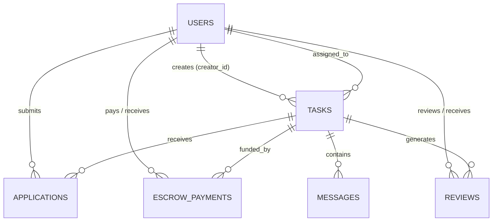

# CampusNeighbor Database Data Dictionary & Relational Architecture

## Entity Relationship Overview

---

## Tables and Column Specifications

### 1. `users` Table
Stores authentication credentials, university credentials, profile details, and role privileges.

| Column | Type | Constraints | Description |
| :--- | :--- | :--- | :--- |
| `id` | `VARCHAR(36)` | `PRIMARY KEY` | UUID v4 unique identifier |
| `email` | `VARCHAR(255)` | `UNIQUE, NOT NULL, INDEXED` | User email for login and notifications |
| `password_hash` | `VARCHAR(255)` | `NOT NULL` | Salted bcrypt / argon2 password hash |
| `name` | `VARCHAR(100)` | `NOT NULL` | Display full name |
| `role` | `VARCHAR(20)` | `CHECK ('neighbor', 'student', 'admin')` | User role permissions |
| `college` | `VARCHAR(200)` | `NULLABLE` | University/College name for students |
| `avatar` | `VARCHAR(500)` | `NULLABLE` | URL or path to user avatar photo |
| `bio` | `TEXT` | `NULLABLE` | Profile description / pitch summary |
| `is_verified` | `BOOLEAN` | `DEFAULT FALSE` | Official verification status |
| `is_active` | `BOOLEAN` | `DEFAULT TRUE` | Soft-deactivation / admin suspension |
| `created_at` | `TIMESTAMP` | `DEFAULT CURRENT_TIMESTAMP` | Record creation timestamp (UTC) |
| `updated_at` | `TIMESTAMP` | `DEFAULT CURRENT_TIMESTAMP` | Record update timestamp (UTC) |

---

### 2. `tasks` Table
Represents local neighborhood chores posted by residents.

| Column | Type | Constraints | Description |
| :--- | :--- | :--- | :--- |
| `id` | `VARCHAR(36)` | `PRIMARY KEY` | UUID v4 unique chore identifier |
| `creator_id` | `VARCHAR(36)` | `FOREIGN KEY (users.id) ON DELETE CASCADE` | The resident who posted the chore |
| `title` | `VARCHAR(200)` | `NOT NULL` | Concise summary of the chore |
| `description` | `TEXT` | `NOT NULL` | Detailed instructions & requirements |
| `category` | `VARCHAR(100)` | `INDEXED, NOT NULL` | One of the 9 chore categories |
| `budget` | `DOUBLE PRECISION`| `CHECK (budget > 0)` | Task budget in Indian Rupees (₹ INR) |
| `lat` | `DOUBLE PRECISION`| `INDEXED, NOT NULL` | Geolocation latitude (-90 to +90) |
| `lon` | `DOUBLE PRECISION`| `INDEXED, NOT NULL` | Geolocation longitude (-180 to +180) |
| `address` | `VARCHAR(300)` | `NOT NULL` | Human-readable locality / address |
| `status` | `VARCHAR(30)` | `CHECK ('open','assigned','in_progress','completed','cancelled')` | Lifecycle status |
| `assigned_to`| `VARCHAR(36)` | `FOREIGN KEY (users.id) ON DELETE SET NULL` | Student helper hired |
| `completion_notes`| `TEXT` | `NULLABLE` | Notes submitted upon chore completion |
| `created_at` | `TIMESTAMP` | `DEFAULT CURRENT_TIMESTAMP` | Creation time |
| `updated_at` | `TIMESTAMP` | `DEFAULT CURRENT_TIMESTAMP` | Last updated |

---

### 3. `applications` Table
Stores student bids and pitches for chores.

| Column | Type | Constraints | Description |
| :--- | :--- | :--- | :--- |
| `id` | `VARCHAR(36)` | `PRIMARY KEY` | UUID v4 |
| `task_id` | `VARCHAR(36)` | `FOREIGN KEY (tasks.id) ON DELETE CASCADE` | Associated task |
| `student_id` | `VARCHAR(36)` | `FOREIGN KEY (users.id) ON DELETE CASCADE` | Applicant student |
| `proposed_fee`| `DOUBLE PRECISION`| `CHECK (proposed_fee > 0)` | Student bid in ₹ INR |
| `pitch` | `TEXT` | `NOT NULL` | Student pitch note and qualifications |
| `status` | `VARCHAR(30)` | `CHECK ('applied', 'accepted', 'rejected')` | Application status |
| `created_at` | `TIMESTAMP` | `DEFAULT CURRENT_TIMESTAMP` | Timestamp |
| *Constraint* | `UNIQUE` | `(task_id, student_id)` | Prevents duplicate bidding spam |

---

### 4. `escrow_payments` Table
Maintains transaction ledgers and automated escrow guarantees.

| Column | Type | Constraints | Description |
| :--- | :--- | :--- | :--- |
| `id` | `VARCHAR(36)` | `PRIMARY KEY` | UUID v4 |
| `task_id` | `VARCHAR(36)` | `FOREIGN KEY (tasks.id) ON DELETE CASCADE` | Associated chore |
| `payer_id` | `VARCHAR(36)` | `FOREIGN KEY (users.id) ON DELETE CASCADE` | Resident payer |
| `payee_id` | `VARCHAR(36)` | `FOREIGN KEY (users.id) ON DELETE CASCADE` | Student payee |
| `amount` | `DOUBLE PRECISION`| `CHECK (amount > 0)` | Escrow amount in ₹ INR |
| `status` | `VARCHAR(30)` | `CHECK ('pending', 'escrow_held', 'released', 'refunded')` | Escrow state machine |
| `razorpay_order_id` | `VARCHAR(100)` | `NULLABLE` | Gateway order identifier |
| `razorpay_payment_id` | `VARCHAR(100)` | `NULLABLE` | Gateway transaction confirmation ID |
| `created_at` | `TIMESTAMP` | `DEFAULT CURRENT_TIMESTAMP` | Deposit time |
| `released_at`| `TIMESTAMP` | `NULLABLE` | Timestamp of confirmation release |
